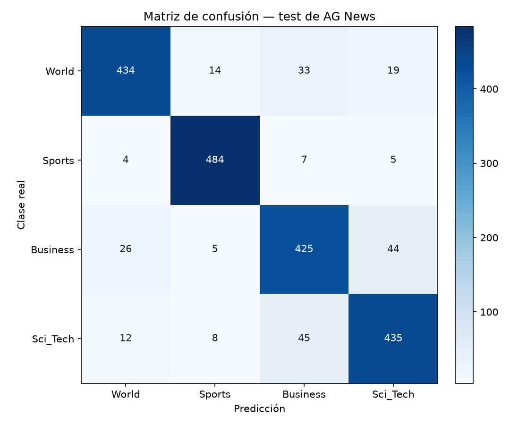

# Clasificador supervisado con TF-IDF — Preentrega DSIII

Clasificación de noticias de AG News con el preprocesamiento del módulo anterior, `TfidfVectorizer` y una regresión logística. El mismo corpus sigue de punta a punta: `ag_news_train.csv` (8.000) y `ag_news_test.csv` (2.000), cuatro clases balanceadas (`World`, `Sports`, `Business`, `Sci_Tech`).

## Cómo ejecutar

Desde la raíz del proyecto, con el modelo `en_core_web_sm` de spaCy ya descargado:

```bash
pip install -r requirements.txt
python -m spacy download en_core_web_sm
python -m src.classify_tfidf
```

El script escribe en `resultados/tfidf/`. Esa carpeta va en el repositorio (`outputs/` está en `.gitignore` y no se sube):

- `classification_report.txt` — precision, recall y F1 por clase
- `matriz_confusion.png` — matriz de confusión del test
- `metrics.json` — experimentos de validación cruzada, métricas y coeficientes

## Pipeline

1. **Carga.** `cargar("ag_news")` lee los splits de la cátedra. No se vuelve a mezclar el test con el train.
2. **Preprocesamiento.** `preprocess_corpus` (`src/preprocess.py`) limpia HTML, URLs y signos, pasa a minúsculas y lematiza con spaCy. Cada documento se procesa solo: no hay conteos ni vocabularios estimados sobre el test.
3. **Stop-words.** Se reutiliza la lista del EDA: stop-words de scikit-learn unidas a las de spaCy (330 términos). El EDA las había encontrado todavía entre las palabras más frecuentes después de lematizar. TF-IDF les baja el peso, y filtrarlas además achica la matriz.
4. **Vectorización y modelo.** Un `Pipeline` de scikit-learn junta `TfidfVectorizer` y `LogisticRegression`. El `fit` del pipeline, y por lo tanto el `fit` del vectorizador, recibe únicamente el train. El test entra al final, por `transform` y `predict`.
5. **Elección de parámetros.** `max_features` y `ngram_range` se comparan con `StratifiedKFold` (3 folds) sobre el train. El F1-macro de cada fold sale de un vectorizador reajustado en ese fold, así que el vocabulario de la porción de validación no se filtra. El test no participa de esta elección.

## Por qué regresión logística

El texto queda en una matriz dispersa de miles de columnas. En ese espacio un clasificador lineal es el modelo de referencia habitual, y es el que la cátedra marca como baseline de AG News.

La regresión logística multinomial (`solver="lbfgs"`, `C=1.0`) estima un peso por n-grama y por clase. Esos pesos se leen directo: `team` y `game` empujan Sports, `iraq` y `president` empujan World. Naive Bayes multinomial es el otro clásico sobre conteos, pero trata los tokens como independientes dada la clase, y esa hipótesis se debilita cuando el vector incluye bigramas. LinearSVC traza un margen parecido; la regresión, con los coeficientes a la vista, deja más claro qué términos sostienen cada categoría y sirve de comparación para el modelo neuronal del módulo siguiente.

Las cuatro clases tienen 2.000 noticias en el train, así que no hace falta `class_weight`. `C` quedó en 1.0: no se barrió sobre el test.

## Parámetros del vectorizador

La validación cruzada eligió **20.000 features, unigramas y bigramas**.

| max_features | n-gramas | F1-macro (CV en train) |
| ---: | --- | ---: |
| 5.000 | 1–1 | 0.8771 ± 0.0064 |
| 10.000 | 1–1 | 0.8789 ± 0.0062 |
| 10.000 | 1–2 | 0.8789 ± 0.0072 |
| **20.000** | **1–2** | **0.8813 ± 0.0071** |

El salto es chico, del orden de 0.4 puntos entre la grilla más simple y la elegida. Las noticias son cortas (mediana de unas 38 palabras en el EDA), así que los bigramas aportan expresiones de tema sin cambiar el problema. `max_features` se quedó con los 20.000 n-gramas de mayor frecuencia en el train: el vocabulario final tiene exactamente 20.000 términos, o sea que el tope está activo y corta la cola de n-gramas raros.

El resto, fijo en todas las variantes:

| Parámetro | Valor | Para qué |
| --- | --- | --- |
| `min_df` | 2 | Descarta n-gramas que aparecen en un solo documento de entrenamiento |
| `max_df` | 0.95 | Descarta términos presentes en más del 95 % del train |
| `sublinear_tf` | `True` | Aplica log(1 + tf) para que una repetición dentro de la nota no domine el vector |
| `stop_words` | 330 términos | Lista combinada de scikit-learn y spaCy |
| `lowercase` | `False` | La limpieza ya dejó el texto en minúsculas |
| `token_pattern` | `\b[a-z]{2,}\b` | Parte los lemas que devuelve el preprocesamiento |

La matriz de entrenamiento queda en 8.000 × 20.000 y la de test en 2.000 × 20.000. Ambas salen del vocabulario aprendido en el train.

## Resultados en el test

2.000 noticias, 500 por clase. Accuracy **0.8890**. F1-macro **0.8889**. Como las clases están balanceadas, el F1 ponderado coincide con el macro. Queda al lado del baseline de referencia del corpus (F1-macro alrededor de 0.90 con regresión logística).

| Clase | Precision | Recall | F1 | Support |
| --- | ---: | ---: | ---: | ---: |
| World | 0.9118 | 0.8680 | 0.8893 | 500 |
| Sports | 0.9472 | 0.9680 | 0.9575 | 500 |
| Business | 0.8333 | 0.8500 | 0.8416 | 500 |
| Sci_Tech | 0.8648 | 0.8700 | 0.8674 | 500 |
| macro | 0.8893 | 0.8890 | 0.8889 | 2000 |

### Matriz de confusión



Filas: clase real. Columnas: predicción.

|  | World | Sports | Business | Sci_Tech |
| --- | ---: | ---: | ---: | ---: |
| World | 434 | 14 | 33 | 19 |
| Sports | 4 | 484 | 7 | 5 |
| Business | 26 | 5 | 425 | 44 |
| Sci_Tech | 12 | 8 | 45 | 435 |

### Qué categorías cuestan más

**Sports** es la clase fácil: 484 de 500. Los coeficientes más altos son `team`, `game`, `coach`, `win`, `season`, `cup`. Ese vocabulario casi no se mezcla con el resto, y la fila de Sports en la matriz está prácticamente vacía fuera de la diagonal.

**Business** es la más difícil (F1 0.8416, y la precision más baja, 0.8333). De sus 75 errores, 44 van a Sci_Tech y 26 a World. **Sci_Tech** es la siguiente (F1 0.8674): 45 de sus 65 errores caen en Business.

El cruce dominante es **Business ↔ Sci_Tech** (44 + 45 = 89 noticias). Una nota de resultados de una empresa de software carga a la vez `company`, `profit` o `share` y `software`, `microsoft` o `internet`. El modelo lineal tiene que quedarse con una sola etiqueta. El segundo cruce es **World ↔ Business** (33 + 26 = 59). `oil` y `economy` pesan en Business, y el mismo hecho puede ser una nota de mercados o una nota de política internacional.

World tiene el recall más bajo (0.8680): 33 de sus fallos se etiquetan como Business. Su precision sigue alta (0.9118): cuando el modelo dice World, en general acierta, y se apoya en términos muy marcados (`iraq`, `president`, `kill`, `minister`).

## Versiones

Entorno en el que corrió este checkpoint:

| Librería | Versión |
| --- | --- |
| scikit-learn | 1.9.0 |
| pandas | 3.0.5 |
| spacy | 3.8.18 |
| matplotlib | 3.11.2 |
| numpy | 2.4.6 |

`requirements.txt` fija los mínimos de instalación (`scikit-learn`, `pandas`, `spacy`, `matplotlib`, `numpy` y las dependencias del hito anterior en PyTorch).

## Hito anterior — pipeline en PyTorch

`python -m src.train` entrena un MLP sobre `data/synthetic_classification.csv` (4 features, 3 clases). El 20 % de cada clase queda en validación, y la media y el desvío se calculan solo con entrenamiento.

Corrida de referencia: PyTorch 2.6.0+cu124, CUDA, Adam, `lr=0.001`, `CrossEntropyLoss`, 30 épocas, arquitectura 4 → 16 (ReLU) → 3. La pérdida de entrenamiento pasó de 1.0584 a 0.1076 y la de validación de 1.0064 a 0.1459, sin rebote. El accuracy de validación cerró en 0.9556.
